# Описание UI-концепций NutriDay

Скриншоты сгенерированы в [v0.dev](https://v0.dev) по промптам из `v0_prompts.md`.  
Именование: `concept-{N}-…` (desktop и mobile отдельно).

---

## Concept 1 — Minimalist clean food app

**Композиция:** Home + каталог наборов (+ корзина, mobile).  
**Палитра:** крем / stone, глубокий forest green, спокойная food-фотография.  
**Язык UI:** русский.

### Desktop

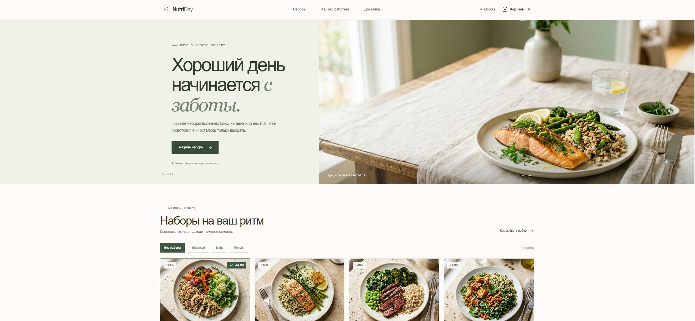

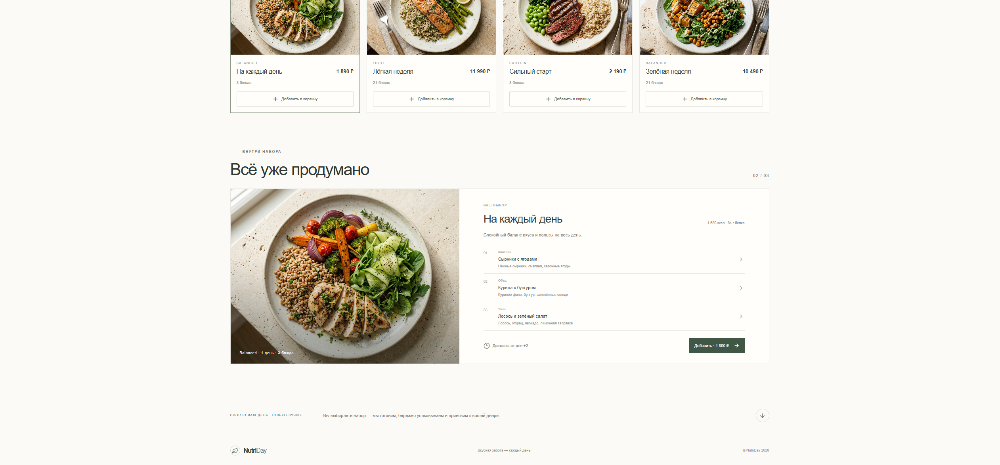

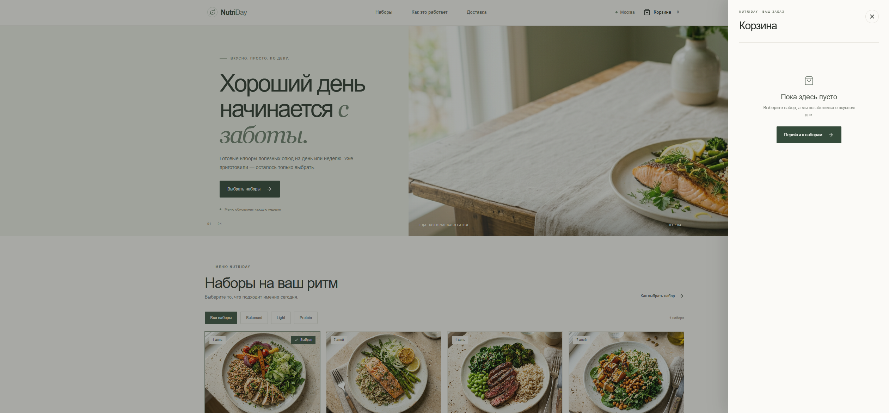

### Mobile

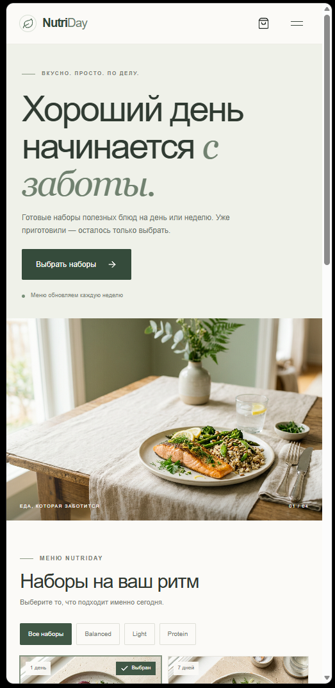

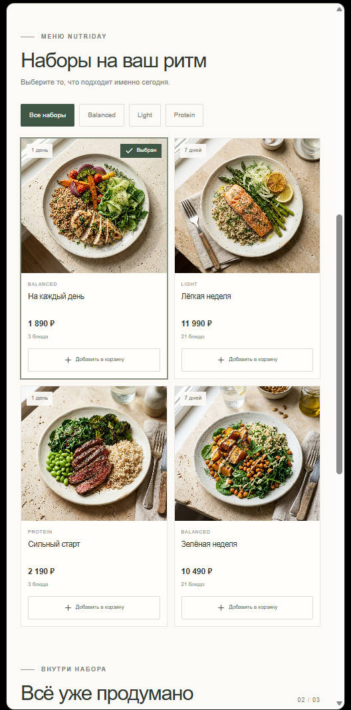

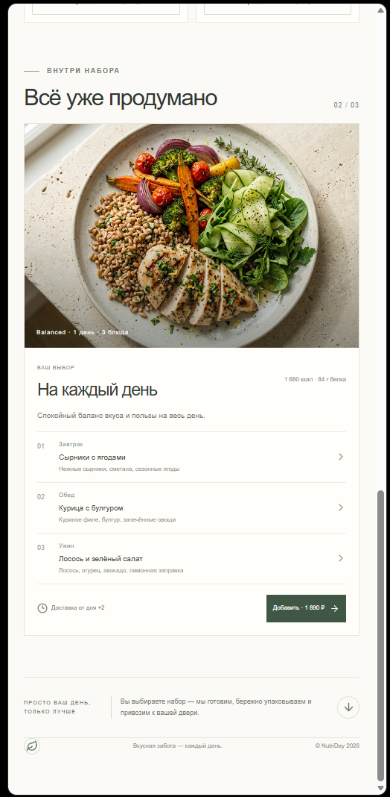

### Ключевые черты
- Много воздуха, hero «Хороший день начинается с заботы», CTA «Выбрать наборы»
- Фильтры рационов (Все / Balanced / Light / Protein), карточки «1 день» / «7 дней»
- Корзина в том же спокойном стиле; mobile-first колонка с тем же брендом

### Плюсы
- Цельный happy path: лендинг → каталог → корзина на desktop и mobile
- Русский UI совпадает с ЦА и ТЗ курса
- Низкий визуальный шум — удобно для MVP без кастомизации и AI

### Минусы
- Меньше «вау», чем у яркого Concept 2
- Онбординг слабее, чем у Concept 3 (ценность объясняется hero, без отдельного 3-шагового блока)

---

## Concept 2 — Bright energetic lifestyle

**Композиция:** корзина + выбор даты доставки (desktop/mobile).  
**Палитра:** крем, солнечный жёлтый, коралловые акценты, serif-заголовки.  
**Язык UI:** английский (в моках).

### Desktop

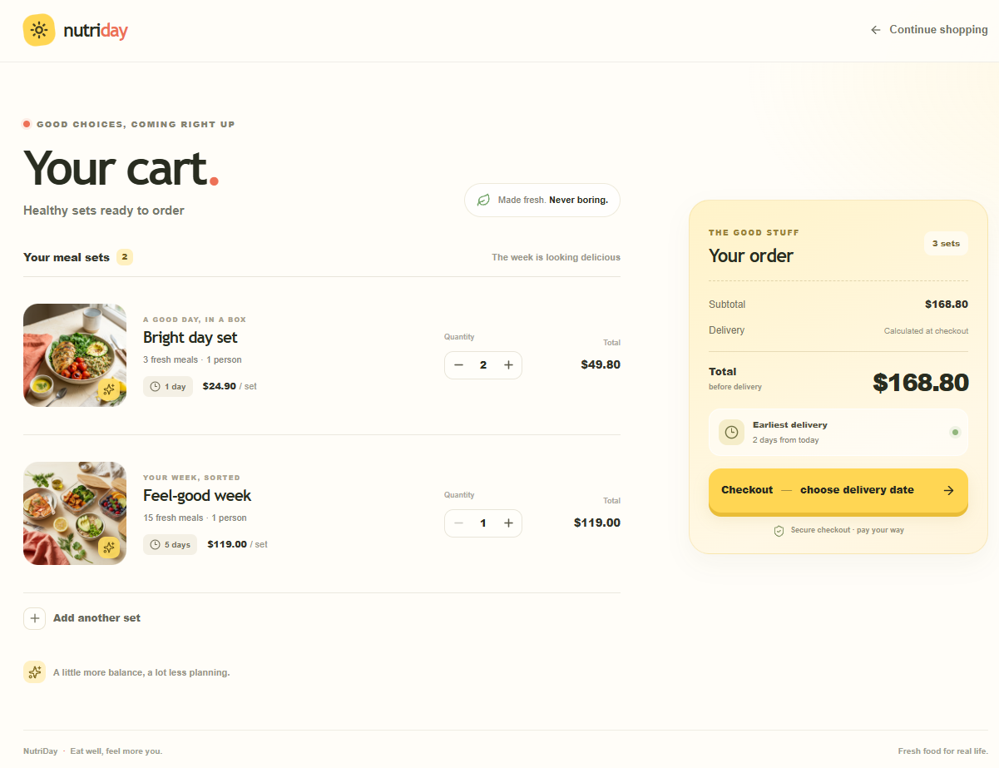

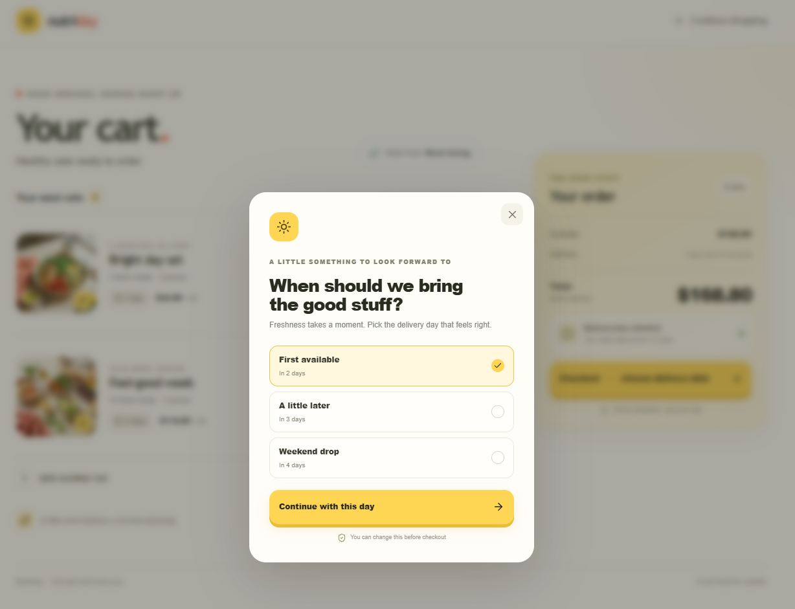

### Mobile

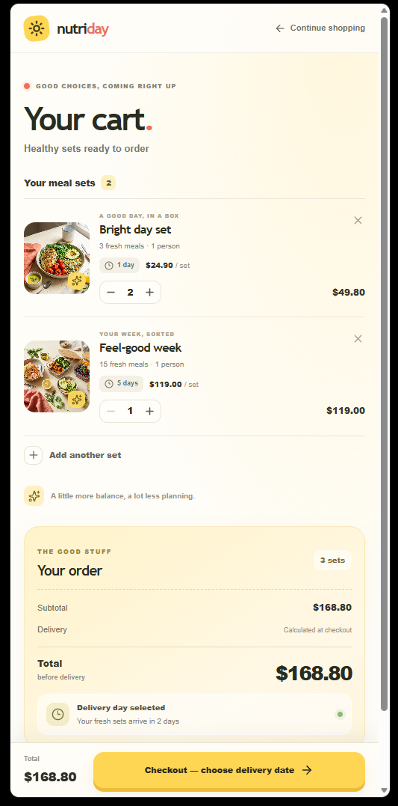

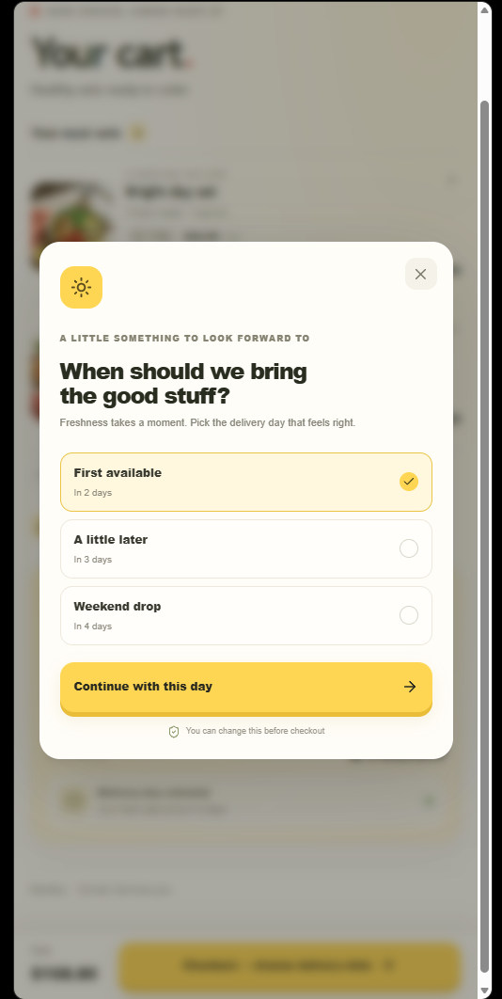

### Ключевые черты
- Фокус на конверсии: степперы количества, крупный итог, CTA к дате доставки
- Явный блок «Earliest delivery: 2 days from today»
- Energetic lifestyle, не «клинический» wellness

### Плюсы
- Лучше всех показывает checkout-сценарий и правило «+2 дня»
- Сильный акцент на оплату/оформление — полезно как референс экранов ДЗ4

### Минусы
- Английский копирайт расходится с русским MVP NutriDay
- Нет экрана каталога/онбординга в этом наборе скринов — концепт «кусочный»
- Яркость может спорить с образом «спокойного ЗОЖ» для ЦА 25–45

---

## Concept 3 — Corporate trustworthy wellness brand

**Композиция:** онбординг + вход в каталог (desktop/mobile).  
**Палитра:** тёмный forest green + светлая панель каталога, serif-заголовки.  
**Язык UI:** русский.

### Desktop

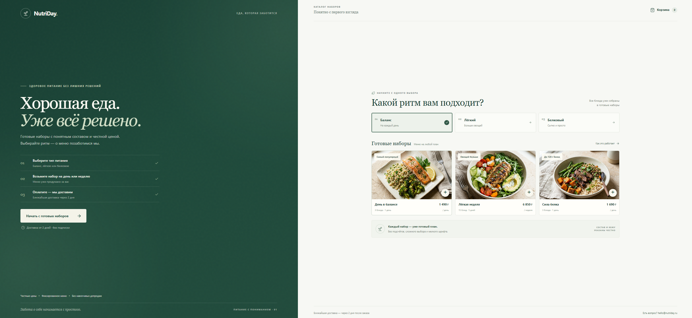

### Mobile

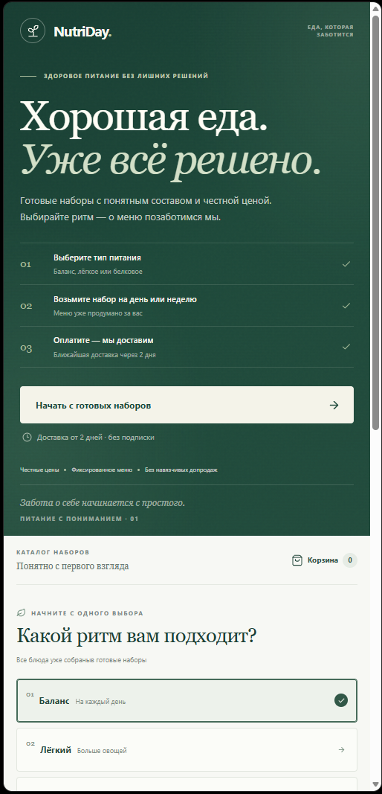

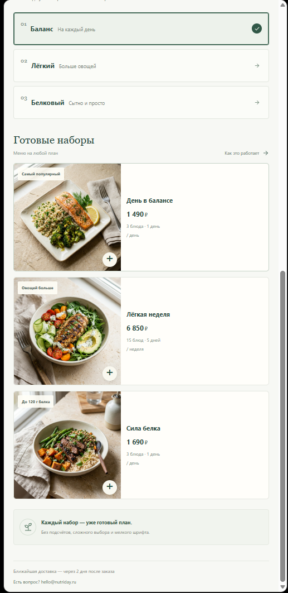

### Ключевые черты
- Три шага: тип питания → набор день/неделя → оплата и доставка
- Плитки «Баланс / Лёгкий / Белковый», карточки с ценами в ₽
- Trust-строки: честные цены, фиксированное меню, без навязчивых продаж; доставка через 2 дня

### Плюсы
- Максимальное доверие и ясность ценности при первом визите
- Хорошо объясняет MVP-ограничения (фиксированное меню, без AI-upsell)

### Минусы
- Нет экранов корзины/чекаута в наборе скринов
- Split onboarding тяжелее масштабировать на все экраны продукта
- Визуально чуть «тяжелее» и корпоративнее, чем лёгкий food-стартап

---

## Выбор

**Итоговая концепция для NutriDay MVP: Concept 1 (minimalist clean food).**

### Обоснование
1. **Покрытие сценариев.** Есть desktop и mobile для home, меню и корзины — это основной путь US-01…US-03 и база для ДЗ4.  
2. **Согласованность с продуктом.** Русский UI, цены/наборы «день/неделя», спокойный food-бренд без AI и без перегруза — совпадает с `project_description.md` и ТЗ.  
3. **Реализуемость.** Единая палитра и компоненты проще перенести в Next.js + Tailwind, чем смешивать жёлтый lifestyle (Concept 2) и тяжёлый corporate split (Concept 3).

### Что берём из альтернатив (без смены концепта)
- Из **Concept 2** — паттерн экрана даты доставки (≥+2 дня) и sticky summary заказа на checkout.  
- Из **Concept 3** — короткий блок «3 шага» и trust-микрокопи на лендинге/чекауте.

### Сводка файлов

| Концепт | Файлы |
|---------|--------|
| 1 | `concept-1-01.png`, `concept-1-02.png`, `concept-1-03-cart.png`, `concept-1-mobile-01.png`, `concept-1-mobile-02.png`, `concept-1-mobile-03.png` |
| 2 | `concept-2-01-cart.png`, `concept-2-02-choose-delivry-date.png`, `concept-2-mobile-01-cart.png`, `concept-2-mobile-02-choose-delivry-date.png` |
| 3 | `concept-3-01.png`, `concept-3-mobile-01.png`, `concept-3-mobile-02.png` |
